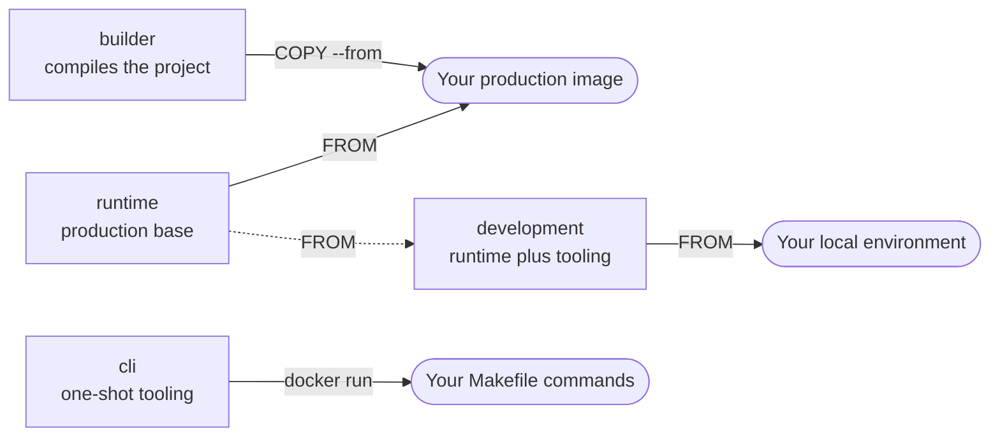
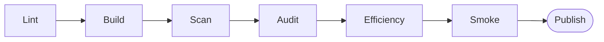

# Docker images

[](https://github.com/gustavofreze/docker-images/actions/workflows/cd.yml)
[](LICENSE)

Hardened, reproducible container base images for PHP, Python, and Rust projects. Every image is pinned to an exact
upstream release, runs non-root where an application runs it, and is published only after it passes one verification
gate on `linux/amd64` and `linux/arm64`.

* [Images](#images)
    - [Targets](#targets)
    - [Tags](#tags)
* [Usage](#usage)
    - [Usage contract](#usage-contract)
* [Verification gate](#verification-gate)
* [Premises](#premises)
* [Development](#development)
    - [Layout](#layout)
* [License](#license)

<div id='images'></div>

## Images

| Family | Upstream | Docker Hub                                                                                                                    | Runtime size                                                                                                                                     | GitHub Packages                                                                                    | Reference                         |
|:-------|:---------|:------------------------------------------------------------------------------------------------------------------------------|:-------------------------------------------------------------------------------------------------------------------------------------------------|:---------------------------------------------------------------------------------------------------|:----------------------------------|
| PHP    | 8.5      | [](https://hub.docker.com/r/gustavofreze/php)       | [](https://hub.docker.com/r/gustavofreze/php)        | [ghcr.io/gustavofreze/php](https://github.com/gustavofreze/docker-images/pkgs/container/php)       | [README](images/php/README.md)    |
| Python | 3.14     | [](https://hub.docker.com/r/gustavofreze/python) | [](https://hub.docker.com/r/gustavofreze/python) | [ghcr.io/gustavofreze/python](https://github.com/gustavofreze/docker-images/pkgs/container/python) | [README](images/python/README.md) |
| Rust   | 1.100    | [](https://hub.docker.com/r/gustavofreze/rust)     | [](https://hub.docker.com/r/gustavofreze/rust)    | [ghcr.io/gustavofreze/rust](https://github.com/gustavofreze/docker-images/pkgs/container/rust)     | [README](images/rust/README.md)   |

Each family README is the reference for that family: its published tags, what the images bake in, and how to consume
them. It is published as the Docker Hub overview of that repository whenever it changes.

<div id='targets'></div>

### Targets

Every family ships the same four targets from one multi-target `Dockerfile`. The stage name is the role, and the four
names are a closed vocabulary.



| Target        | What it is                                                                          | Last user |
|:--------------|:------------------------------------------------------------------------------------|:----------|
| `builder`     | Compilation base a project inherits via `FROM`, discarded in the multi-stage build. | non-root  |
| `runtime`     | Production image the platform runs.                                                 | non-root  |
| `development` | Variant of `runtime` built `FROM runtime`, adding local development tooling.        | non-root  |
| `cli`         | Local command-line tooling for one-shot commands, invoked from a project Makefile.  | root      |

`development` is subordinate to `runtime`, not a peer of it. It runs on a developer machine and is never deployed. The
`cli` images keep root as a named, justified exception, because they are invoked over a bind mount owned by the caller
and must be able to write into it. A `HEALTHCHECK` ships only on a target that starts a long-running process of its
own.

<div id='tags'></div>

### Tags

```
gustavofreze/<family>:<upstream-minor>-<target>-<version>
              │        │                │        └── build unit version, immutable once published
              │        │                └─────────── builder, runtime, development or cli
              │        └──────────────────────────── upstream line, for example 8.5, 3.14 or 1.100
              └───────────────────────────────────── php, python or rust
```

There is no bare tag and `latest` is forbidden. Every target is published in two forms, and which one a project takes
is the consumer's call:

|              | Versioned tag                              | Floating alias                             |
|:-------------|:-------------------------------------------|:-------------------------------------------|
| Form         | `<upstream-minor>-<target>-<version>`      | `<upstream-minor>-<target>`                |
| Example      | `8.5-runtime-<version>`                    | `8.5-runtime`                              |
| Moves        | Only when you bump it                      | On every rebuild, once the client re-pulls |
| Reproducible | Yes                                        | No                                         |
| Fits         | `runtime` and `builder`, anything shipping | `cli` and `development`, local tooling     |

An alias never crosses an upstream minor, so `8.5-runtime` stays on 8.5 after 8.6 ships. A monthly rebuild repoints
the aliases and refreshes the packages this repository installs itself. The inherited base moves forward only through
a new versioned tag. An alias floats only when the client re-pulls, so `--pull=always` on `docker run` (or
`pull_policy: always` in compose) is what actually makes it move.

<div id='usage'></div>

## Usage

A project consumes a base in two thin files and adds only its own dependencies, code, and tuning. The shape is the
same in every family:

```dockerfile
# syntax=docker/dockerfile:1
FROM gustavofreze/<family>:<upstream-minor>-builder-<version> AS builder
RUN <install the dependencies, then build the code>

FROM gustavofreze/<family>:<upstream-minor>-runtime-<version>
COPY --from=builder <what the build produced> <where the runtime expects it>
```

```shell
docker run --rm -v "$(pwd)":<workdir> gustavofreze/<family>:<upstream-minor>-cli <command>
```

The concrete, copy-ready snippets live in each family README: [PHP](images/php/README.md#how-to-use-this-image),
[Python](images/python/README.md#how-to-use-this-image), and [Rust](images/rust/README.md#how-to-use-this-image).

<div id='usage-contract'></div>

### Usage contract

The rules that hold across every family:

1. **Choose the tag form deliberately.** The versioned tag is the default for anything that ships, because it keeps a
   rollback reproducible. The alias trades that for the monthly rebuild arriving without a pull request.
2. **Do not re-declare what the base provides.** Extensions, the non-root user, hardening, OPcache defaults, the
   virtual environment path, the health check, the interpreter defaults, the Rust toolchain paths.
3. **Ship a `.dockerignore`** next to each Dockerfile, and never copy a secret into a build context.
4. **Pass build-time credentials through a BuildKit secret** (`RUN --mount=type=secret,id=<name>`), never through a
   baked `ARG` or `ENV`.
5. **Put dependency layers before code layers**, so a code change does not invalidate the dependency cache.

<div id='verification-gate'></div>

## Verification gate

No tag is published before it passes the whole gate. `make review` runs it locally, and the `CI` and `CD` workflows
run the same command on a native `linux/amd64` runner and a native `linux/arm64` one.



| Stage      | Tool                 | What stops the gate                                                              |
|:-----------|:---------------------|:---------------------------------------------------------------------------------|
| Lint       | hadolint, ShellCheck | A Dockerfile or shell finding, or a family README that disagrees with its build. |
| Build      | BuildKit             | A target that does not build.                                                    |
| Scan       | Trivy and Grype      | A fixable HIGH or CRITICAL vulnerability. Neither scanner is a superset.         |
| Audit      | Dockle               | A CIS Docker Benchmark violation: root last user, setuid bits, secrets in `ENV`. |
| Efficiency | dive                 | Wasted layer space: an unpruned build dependency or a forgotten cache.           |
| Smoke      | `scripts/smoke`      | A broken runtime contract, asserted in throwaway containers.                     |

Every validator runs in a container, so nothing beyond Docker and GNU Make is installed on the host. Each validator
version is written once, in `docker-compose.yml`, where Dependabot tracks it. Every suppression and threshold is
written down with its justification and its date: `.hadolint.yaml`, `.dive-ci`, `.dive-ci-shadowed`, and the CIS
exemptions beside the audit runner in the `Makefile`.

A finding that cannot be fixed locally is disclosed, not hidden. The family publishes an
[OpenVEX](https://openvex.dev) analysis as a cosign attestation next to every image, and `affected` statements are
reported rather than silenced. Only Python carries one today, and [its README](images/python/README.md#verification)
shows how a scanner reads it.

<div id='premises'></div>

## Premises

| Premise                   | What it means                                                                                 |
|:--------------------------|:----------------------------------------------------------------------------------------------|
| Exact upstream pins       | Every `FROM` names a patch version and a distro release, and package trees are locked.        |
| Hermetic builds           | Nothing is fetched at build time without a pinned version and a verified sha256.              |
| Non-root by default       | Every target an application runs drops to an unprivileged user.                               |
| Lean layers               | One `RUN` per concern, build-only dependencies deleted in the same layer, `COPY` never `ADD`. |
| Immutable versioned tags  | Any change to a Dockerfile or its inputs publishes a new version instead of rewriting one.    |
| A gate before publication | Neither the Makefile nor the CD workflow can publish an unreviewed image.                     |

<div id='development'></div>

## Development

```bash
git clone https://github.com/gustavofreze/docker-images.git
cd docker-images

make build       # build every family, or make build-<family>
make review      # the full gate, or make review-<family>
make discover    # every build unit and the tags it publishes
make help        # every other command
```

[CONTRIBUTING.md](CONTRIBUTING.md) covers the rest: the pull request workflow, the versioning rules, adding a family
or an upstream version, handling a vulnerability, and how publication works.

<div id='layout'></div>

### Layout

Every family lives under `images/`, with one self-contained build unit per upstream minor and a family `README.md` one
level up.

<details>
<summary>Repository tree</summary>

```
docker-images/
├── Makefile                        # build, review, publish
├── docker-compose.yml              # validator image versions, single source, Dependabot tracked
├── vex/                            # per-CVE analysis, published with the images as an attestation
│   └── python.openvex.json         # one file per family that has one, and php and rust currently have none
├── .grype/                         # gate policy for Grype: risks with no remediation, per family
│   └── python.yaml
├── .trivy/                         # the same acceptance for Trivy, which names them differently
│   └── python.yaml
├── scripts/
│   ├── smoke-lib.sh                # shared host-side smoke helpers every family sources
│   ├── bump-build-unit.sh          # moves a build unit VERSION and every tag and pin its README names
│   ├── discover-images.sh          # build matrix: one entry per target, read from the Dockerfiles
│   ├── changed-build-units.sh      # the build units a commit range touches, read by the version guard
│   └── check-documentation.sh      # asserts every family README still agrees with its build units
└── images/
    ├── php/
    │   ├── README.md               # family reference, published as the Docker Hub overview
    │   ├── DESCRIPTION             # the Docker Hub short description, one line
    │   └── 8.5/                    # build unit for the 8.5 upstream line
    │       ├── Dockerfile          # multi-target: builder, cli, runtime, development
    │       ├── VERSION             # base semantic version for this line
    │       ├── .dockerignore
    │       ├── bin/                # binaries baked into the images (FPM health check)
    │       ├── conf/               # PHP, OPcache, Xdebug, and FPM configuration
    │       └── scripts/smoke       # boots throwaway containers, asserts the runtime contract
    ├── python/
    │   ├── README.md
    │   ├── DESCRIPTION
    │   └── 3.14/                   # build unit for the 3.14 upstream line
    │       ├── Dockerfile
    │       ├── VERSION
    │       ├── .dockerignore
    │       ├── requirements.txt    # the tools the image installs, tracked by Dependabot
    │       ├── requirements-development.txt
    │       ├── constraints.txt     # the tree they resolve to, so a build is reproducible
    │       └── scripts/smoke
    └── rust/
        ├── README.md
        ├── DESCRIPTION
        └── 1.100/                  # build unit for the 1.100 upstream line
            ├── Dockerfile
            ├── VERSION
            ├── .dockerignore
            └── scripts/smoke
```

</details>

<div id='license'></div>

## License

Collection is licensed under [MIT](LICENSE).
