# gustavofreze/php

Hardened, reproducible PHP base images. One Dockerfile per upstream version ships four targets: the production `runtime`
(PHP-FPM), its `development` variant, the `builder` for a project's production build, and a `cli` tooling image a
project Makefile invokes.

## Quick reference

- **Maintained by:** [Gustavo Freze](https://github.com/gustavofreze)
- **Source:** [gustavofreze/docker-images](https://github.com/gustavofreze/docker-images)
- **File an issue:** [docker-images/issues](https://github.com/gustavofreze/docker-images/issues)
- **Also published as:** `ghcr.io/gustavofreze/php`
- **Architectures:** `linux/amd64`, `linux/arm64`
- **Supply chain:** every tag ships a build provenance attestation and an SBOM, and carries no accepted risk
- **License:** [MIT](https://github.com/gustavofreze/docker-images/blob/main/LICENSE)

## Supported tags

| Tag                      | Alias             | Purpose                                                         |
|:-------------------------|:------------------|:----------------------------------------------------------------|
| `8.5-runtime-1.0.11`     | `8.5-runtime`     | Production PHP-FPM runtime.                                     |
| `8.5-development-1.0.11` | `8.5-development` | Local development: runtime plus Xdebug, Composer, bash, git.    |
| `8.5-builder-1.0.11`     | `8.5-builder`     | Composer toolchain for the builder stage of a production image. |
| `8.5-cli-1.0.11`         | `8.5-cli`         | Makefile tooling: Composer, Xdebug coverage, linters, docker.   |

Every tag is `<upstream-minor>-<target>-<version>`. There is no bare tag and `latest` is forbidden.

- **Versioned tag.** Immutable and reproducible. It moves only when you bump it, so take it for anything that ships.
- **Alias.** Tracks the latest rebuild of its target, the monthly security rebuild included, and never crosses an
  upstream minor: `8.5-runtime` stays on 8.5. It moves only when the client re-pulls, which suits `cli` and local
  development.

All four are built from one multi-target
[Dockerfile](https://github.com/gustavofreze/docker-images/blob/main/images/php/8.5/Dockerfile), pinned to
`php:8.5.12-fpm-alpine3.24`. Every tool it adds is pinned there too.

## Image variants



| Target        | Runs as             | Health check | On top of the base                                                   |
|:--------------|:--------------------|:-------------|:---------------------------------------------------------------------|
| `runtime`     | `www-data` (uid 82) | FPM socket   | Extensions, production hardening, production OPcache.                |
| `development` | `www-data` (uid 82) | FPM socket   | `runtime` plus Xdebug 3, Composer 2, bash, git, development OPcache. |
| `builder`     | `www-data` (uid 82) | none         | Composer 2, git, unzip.                                              |
| `cli`         | root                | none         | `builder` plus Xdebug coverage, bash, curl, linters, the docker CLI. |

- `development` is built `FROM runtime`. It runs on a developer machine and is never deployed.
- `builder` is discarded in the multi-stage application build. It installs dependencies non-root, so the vendor tree
  it produces already carries the runtime's ownership.
- `cli` stays root so it can write into a bind mount owned by the caller.
- Every target is built on the FPM base, so the family shares one base layer. `builder` and `cli` inherit its
  `EXPOSE 9000` as metadata only: nothing in either image listens, and their default command is the interactive PHP
  shell.

## What it provides

Every image provides, and no consuming Dockerfile re-declares:

- **Extensions.** The official image set (curl, sodium, mbstring, and the rest) plus `bcmath`, `pdo_mysql`, and `zip`,
  built with no leftover build dependencies.
- **A non-root runtime.** PHP-FPM runs as `www-data`, with `WORKDIR /var/www/html` owned by it.
- **Current system libraries.** openssl, curl, brotli, and zlib are upgraded to what the Alpine index serves at build
  time, instead of aging in place between base releases.
- **Production hardening.** `php.ini-production` active, `expose_php`, `display_errors`, and `allow_url_include` off,
  arguments stripped from exception traces, strict and transport-locked session cookies, session upload progress
  disabled, and the process escape functions (`exec`, `shell_exec`, `system`, `proc_open`, `popen`, `passthru`)
  disabled. A project that legitimately shells out re-enables what it needs in its own drop-in.
- **OPcache defaults.** Production tuning in `runtime` (no timestamp validation, tracing JIT), development tuning in
  `development` (timestamp validation on, JIT off).
- **A health check** probing the PHP-FPM socket.
- **Graceful shutdown.** The official `STOPSIGNAL SIGQUIT` and exec-form `php-fpm` command are preserved, and
  `process_control_timeout` is 10s, so the master drains in-flight requests inside the default stop timeout of
  `docker stop` and Compose.

`development` also prints undecorated worker output in `docker logs` and re-enables the process functions, so Composer
can run.

The `cli` image is built to be piped and scripted:

- **Linters.** CodeSniffer as `phpcs` and `phpcbf`, Mess Detector as `phpmd`, each fetched over TLS and verified
  against its published sha256 before it enters a layer.
- **Parseable output.** Diagnostics go to `stderr`, never `stdout`, so a `--report=json` run is parseable. `phpmd` is a
  wrapper that silences the deprecation notices Mess Detector raises on PHP 8.5, so its report is the only thing on
  either stream.
- **The docker CLI.** An integration suite that drives throwaway containers can shell out to `docker` against a
  mounted host socket. No other image in this repository carries it. Mounting the socket is root-equivalent on the
  host, so grant it only to a local tooling invocation you control.

## How to use this image

### As a base image

A project consumes the base in two thin files and adds only its own dependencies, code, and tuning:

```dockerfile
# syntax=docker/dockerfile:1
FROM gustavofreze/php:8.5-development-1.0.11
COPY ./ /var/www/html
```

```dockerfile
# syntax=docker/dockerfile:1
FROM gustavofreze/php:8.5-builder-1.0.11 AS builder
COPY composer.json composer.lock ./
RUN composer install --no-dev --no-interaction --prefer-dist --optimize-autoloader
COPY ./ ./
RUN composer dump-autoload --optimize --classmap-authoritative

FROM gustavofreze/php:8.5-runtime-1.0.11
COPY --from=builder --chown=www-data:www-data /var/www/html /var/www/html
```

### As a tooling image

The `cli` image is invoked directly and never appears in a Dockerfile.

To install the project dependencies, run:

```shell
docker run --rm -v "$(pwd)":/var/www/html gustavofreze/php:8.5-cli-1.0.11 composer install
```

To check the code style, run:

```shell
docker run --rm -v "$(pwd)":/var/www/html gustavofreze/php:8.5-cli-1.0.11 phpcs src/
```

### As an FPM service

```yaml
services:
    php:
        image: gustavofreze/php:8.5-development-1.0.11
        volumes:
            - ./:/var/www/html
        expose:
            - "9000"

    nginx:
        image: nginx:alpine
        ports:
            - "80:80"
        volumes:
            - ./public:/var/www/html/public
            - ./nginx.conf:/etc/nginx/conf.d/default.conf
        depends_on:
            - php
```

The rules that hold across every family live in the
[usage contract](https://github.com/gustavofreze/docker-images#usage-contract).

## Verification

No tag is published before it passes the full
[gate](https://github.com/gustavofreze/docker-images#verification-gate), on a native `linux/amd64` runner and a native
`linux/arm64` one:

| Stage      | Tool                 | What it checks                                 |
|:-----------|:---------------------|:-----------------------------------------------|
| Lint       | hadolint, ShellCheck | Every Dockerfile and every `RUN` body.         |
| Scan       | Trivy and Grype      | Fixable HIGH and CRITICAL vulnerabilities.     |
| Audit      | Dockle               | The CIS Docker Benchmark.                      |
| Efficiency | dive                 | Wasted layer space.                            |
| Smoke      | throwaway containers | The runtime contract, in throwaway containers. |

The smoke suite asserts the non-root user, the extensions, the hardening, the OPcache mode, the health check, the pinned
tool versions, and the absence of development tooling in the production surface.

This family carries no accepted risk, so it publishes no [OpenVEX](https://openvex.dev) analysis and no scanner
exemption of any kind. Every scan in the gate runs bare, and what it reports is what the images contain.

To scan a tag yourself, run:

```shell
trivy image gustavofreze/php:8.5-cli-1.0.11
```

## License

[MIT](https://github.com/gustavofreze/docker-images/blob/main/LICENSE)
