# gustavofreze/rust

Hardened, reproducible Rust base images. One Dockerfile per upstream version ships four targets: the production
`runtime` for a static binary, its `development` variant, the `builder` toolchain for a project's production build,
and a `cli` tooling image a project Makefile invokes.

## Quick reference

- **Maintained by:** [Gustavo Freze](https://github.com/gustavofreze)
- **Source:** [gustavofreze/docker-images](https://github.com/gustavofreze/docker-images)
- **File an issue:** [docker-images/issues](https://github.com/gustavofreze/docker-images/issues)
- **Also published as:** `ghcr.io/gustavofreze/rust`
- **Architectures:** `linux/amd64`, `linux/arm64`
- **Supply chain:** every tag ships a build provenance attestation and an SBOM, and carries no accepted risk
- **License:** [MIT](https://github.com/gustavofreze/docker-images/blob/main/LICENSE)

## Supported tags

| Tag                       | Alias               | Purpose                                                          |
|:--------------------------|:--------------------|:-----------------------------------------------------------------|
| `1.100-runtime-1.0.0`     | `1.100-runtime`     | Production base for a static binary. No toolchain, no shell kit. |
| `1.100-development-1.0.0` | `1.100-development` | Local development: runtime plus Cargo, Clippy, rustfmt, git.     |
| `1.100-builder-1.0.0`     | `1.100-builder`     | Cargo and the musl toolchain for the builder stage of an image.  |
| `1.100-cli-1.0.0`         | `1.100-cli`         | Makefile tooling: Cargo, Clippy, rustfmt, git, bash, curl.       |

Every tag is `<upstream-minor>-<target>-<version>`. There is no bare tag and `latest` is forbidden.

- **Versioned tag.** Immutable and reproducible. It moves only when you bump it, so take it for anything that ships.
- **Alias.** Tracks the latest rebuild of its target, the monthly security rebuild included, and never crosses an
  upstream minor: `1.100-runtime` stays on 1.100. It moves only when the client re-pulls, which suits `cli` and local
  development.

All four are built from one multi-target
[Dockerfile](https://github.com/gustavofreze/docker-images/blob/main/images/rust/1.100/Dockerfile), pinned to
`rust:1.100.0-alpine3.24` for the toolchain and to `alpine:3.24.4` for the runtime.

## Image variants



| Target        | Runs as          | On top of the base                                                       |
|:--------------|:-----------------|:-------------------------------------------------------------------------|
| `runtime`     | `app` (uid 1000) | Nothing. A pinned Alpine in a single layer, around 13 MB.                |
| `development` | `app` (uid 1000) | `runtime` plus rustc, Cargo, Clippy, rustfmt, the gcc linker, bash, git. |
| `builder`     | `app` (uid 1000) | The upstream toolchain: rustc and Cargo targeting musl, gcc, `musl-dev`. |
| `cli`         | root             | `builder` plus Clippy, rustfmt, bash, curl, git.                         |

- `runtime` is not built on the Rust image. A release binary targeting musl links statically, so it needs no
  interpreter, no standard library on disk, and no compiler runtime.
- `development` is built `FROM runtime`. It runs on a developer machine and is never deployed.
- `builder` keeps the whole toolchain on purpose. It is the stage a project compiles its binary in, and the
  multi-stage application build discards it.
- `cli` stays root so it can write into a bind mount owned by the caller.
- No target ships a `HEALTHCHECK` or exposes a port. These are language bases, not services, so the application that
  inherits the runtime declares the health check for the process it actually runs.

## What it provides

Every image provides, and no consuming Dockerfile re-declares:

- **A non-root runtime.** The `app` user (uid 1000), whose home is the `/app` working directory it owns.
- **The Alpine certificate bundle** at `/etc/ssl/certs/ca-certificates.crt`, so a binary that verifies TLS against the
  system store works unchanged. A project that trusts a private authority adds the `ca-certificates` package itself.
- **A current zlib**, upgraded to what the Alpine index serves at build time instead of aging in place between base
  releases.
- **`RUST_BACKTRACE=1`** in `runtime` and `development`, so a panic prints its backtrace instead of a hint to set the
  variable.
- **No toolchain in production.** The `runtime` carries no Cargo, no rustc, no linker, no git, no bash, and no curl,
  and the smoke suite asserts each absence.
- **Static binaries with no flag.** A release build in the `builder` links statically against musl, and the smoke
  suite proves it by running one in the `runtime`.
- **A writable `CARGO_HOME`** at the upstream `/usr/local/cargo` wherever the toolchain ships, so the `app` user
  fetches crates into it with no extra configuration.

## How to use this image

### As a base image

A project consumes the base in two thin files and adds only its own dependencies, code, and tuning:

```dockerfile
# syntax=docker/dockerfile:1
FROM gustavofreze/rust:1.100-development-1.0.0
COPY ./ /app
```

```dockerfile
# syntax=docker/dockerfile:1
FROM gustavofreze/rust:1.100-builder-1.0.0 AS builder
COPY Cargo.toml Cargo.lock ./
RUN cargo fetch --locked
COPY ./ ./
RUN cargo build --release --locked --offline

FROM gustavofreze/rust:1.100-runtime-1.0.0
COPY --from=builder --chown=app:app /app/target/release/your-application /app/your-application
CMD ["/app/your-application"]
```

`cargo fetch` reads only the manifest and the lock file, so the dependency download is its own layer and a code change
does not repeat it. A crate that links a C library needs that library's development package in the builder stage and
its shared object in the runtime stage, both added by the project.

### As a tooling image

The `cli` image is invoked directly and never appears in a Dockerfile:

```shell
docker run --rm -v "$(pwd)":/app gustavofreze/rust:1.100-cli-1.0.0 cargo clippy --all-targets -- -D warnings
docker run --rm -v "$(pwd)":/app gustavofreze/rust:1.100-cli-1.0.0 cargo fmt --check
```

The rules that hold across every family live in the
[usage contract](https://github.com/gustavofreze/docker-images#usage-contract).

## Verification

No tag is published before it passes the full
[gate](https://github.com/gustavofreze/docker-images#verification-gate), on a native `linux/amd64` runner and a native
`linux/arm64` one:

| Stage      | Tool                 | What it checks                                 |
|:-----------|:---------------------|:-----------------------------------------------|
| Lint       | hadolint, ShellCheck | Every Dockerfile and every `RUN` body.         |
| Scan       | Trivy and Grype      | Fixable HIGH and CRITICAL vulnerabilities.     |
| Audit      | Dockle               | The CIS Docker Benchmark.                      |
| Efficiency | dive                 | Wasted layer space.                            |
| Smoke      | throwaway containers | The runtime contract, in throwaway containers. |

The smoke suite asserts the non-root user, the pinned toolchain version, linters only where they belong, the absence of
a toolchain in the production surface, and a release binary compiled in the builder running in the runtime.

This family carries no accepted risk, so it publishes no [OpenVEX](https://openvex.dev) analysis and no scanner
exemption of any kind. Every scan in the gate runs bare, and what it reports is what the images contain:

```shell
trivy image gustavofreze/rust:1.100-runtime-1.0.0
```

## License

[MIT](https://github.com/gustavofreze/docker-images/blob/main/LICENSE)
